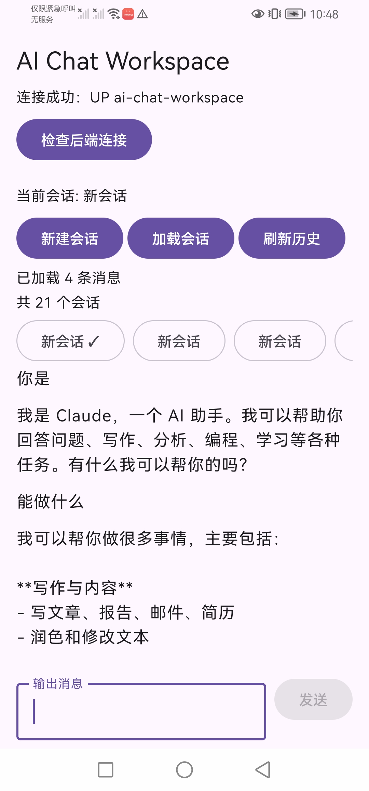
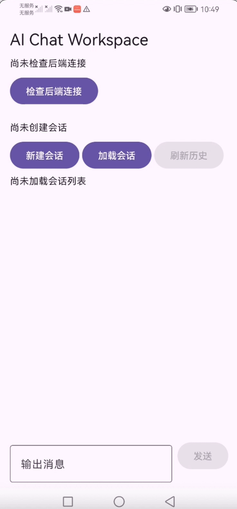

# AI Chat Workspace

一个用于学习 Android 与 Spring Boot 全栈开发的 AI 聊天工作台。Android 客户端通过后端 API 管理会话和消息；后端将对话请求转发给大模型，并把生成内容以流式方式返回客户端。

> **项目状态：** 核心聊天流程已完成并由作者手动验证。启动步骤和演示环境以本地配置为准。

## 功能

- 创建并查看聊天会话
- 发送消息、加载历史消息
- 通过 Server-Sent Events（SSE）接收大模型的流式回复
- 将会话和消息保存到 PostgreSQL
- 提供后端健康检查接口
- 使用环境变量配置数据库凭据和大模型 API 信息

## 演示

| 截图 | 动态演示 |
| --- | --- |
|  |  |

## 技术栈

| 部分 | 技术 |
| --- | --- |
| Android | Kotlin、Jetpack Compose、ViewModel、Kotlin Flow、Retrofit、OkHttp |
| 后端 | Java 21、Spring Boot 4.1.1、Spring MVC、Spring Data JPA、Flyway |
| 数据库 | PostgreSQL 17 |
| 大模型 | DeepSeek API（OpenAI 风格的 Chat Completions 请求与 SSE 流式响应） |
| 本地数据库运行 | Docker Compose |

## 架构

```text
Android 客户端
   │ REST / SSE
   ▼
Spring Boot 后端 ───────► 大模型 API
   │
   ▼
PostgreSQL
```

会话与消息由后端持久化到 PostgreSQL。普通 REST 接口用于创建、查询会话和加载历史消息；发送消息时，Android 调用流式接口，后端读取模型的 SSE 数据并逐段转发给客户端。

## 项目结构

```text
.
├── android/    # Android 客户端
├── backend/    # Spring Boot API、模型调用与数据库迁移
├── deploy/     # PostgreSQL Docker Compose 配置和启动脚本
├── docs/       # 项目文档与演示素材
└── README.md
```

## 本地运行

### 环境要求

- JDK 21
- Android Studio（使用仓库自带的 Gradle Wrapper，无需单独安装 Gradle）
- Docker 与 Docker Compose
- 大模型 API 凭据（通过项目外部配置文件提供）

Maven Wrapper 已包含在 `backend/` 中，无需单独安装 Maven。

### 1. 配置外部环境变量文件

项目统一从仓库外的环境变量文件读取数据库和大模型配置：

```text
../private-config/ai-chat-workspace.env
```

文件中提供以下变量：

```dotenv
POSTGRES_PASSWORD=<本机数据库密码>
AI_BASE_URL=<大模型 API 基础地址>
AI_API_KEY=<大模型 API Key>
AI_MODEL=<模型名称>
```

请在自己的机器上创建并填入实际值，不要将该文件或密钥提交到仓库。`deploy/up.sh` 会读取其中的数据库密码来启动 PostgreSQL；Spring Boot 运行配置需要加载同一个文件，以便应用读取数据库密码和大模型设置。

在 IntelliJ IDEA / Android Studio 的 Spring Boot Run Configuration 中，将该文件设置为环境变量文件（使用 IDE 支持的 env 文件功能或 EnvFile 插件），无需在运行配置里逐项复制变量。使用 IDE 运行配置启动 Spring Boot 即可。若从命令行启动，则需先让当前 shell 从该文件加载环境变量。

### 2. 启动 PostgreSQL

从项目根目录运行：

```bash
./deploy/up.sh
```

脚本会启动 PostgreSQL 容器并在本机的 `5432` 端口提供服务。后端使用 Flyway 自动执行数据库迁移。

### 3. 启动后端

从命令行启动时，确认当前 shell 已从上述外部环境变量文件加载配置，再运行：

```bash
cd backend && ./mvnw spring-boot:run
```

后端默认连接本机 `localhost:5432` 上的 `ai_chat_workspace` 数据库，数据库名和用户名配置在 `backend/src/main/resources/application.properties` 中。

#### 流式请求超时说明

大模型生成首个 token 或连续生成内容可能需要较长时间。项目已将 Spring MVC 异步请求超时和 Android OkHttp 读取超时都配置为 **180 秒**，分别位于 `backend/src/main/resources/application.properties` 和 `android/app/src/main/java/dev/smartconvert/aichat/data/remote/RetrofitClient.kt`。此前遇到的 `AsyncRequestTimeoutException` / Android 发送失败问题通过延长两端超时处理。

若部署环境中的反向代理、网关或模型服务自身有更短的超时限制，仍可能中断连接；遇到长时间没有任何流数据时，可进一步考虑 SSE 心跳，并检查整条链路上的超时设置。

### 4. 配置并运行 Android 客户端

运行 Android 客户端前，需要在 `android/app/src/main/java/dev/smartconvert/aichat/data/remote/RetrofitClient.kt` 中把 `BASE_URL` 改为当前 Android 设备或模拟器实际可访问的后端地址，并保留末尾的 `/`。例如：

```kotlin
private const val BASE_URL = "http://<后端主机地址>:8080/"
```

- Android 模拟器访问运行在开发电脑上的后端时，使用模拟器可访问的宿主机地址（常见 Android Emulator 地址为 `10.0.2.2`）。
- 真机使用开发电脑在当前局域网内的 IP 地址；电脑和手机需处于可互通的网络。
- `localhost` 指向 Android 设备本身，通常不能用来访问开发电脑上的后端。
- 修改地址后再从 Android Studio 运行应用或执行构建命令；后端端口也需要允许设备访问。

然后用 Android Studio 打开 `android/`，等待 Gradle 同步并运行应用；也可在 `android/` 目录执行：

```bash
./gradlew assembleDebug
```

## API 概览

基础路径：`/api/chats`

| 方法 | 路径 | 说明 |
| --- | --- | --- |
| `GET` | `/api/chats` | 获取会话列表 |
| `POST` | `/api/chats` | 创建会话 |
| `GET` | `/api/chats/{chatId}` | 获取单个会话 |
| `GET` | `/api/chats/{chatId}/messages` | 获取会话消息 |
| `POST` | `/api/chats/{chatId}/messages` | 普通方式发送消息 |
| `POST` | `/api/chats/{chatId}/messages/stream` | 通过 SSE 流式发送消息和接收回复 |

健康检查：`GET /actuator/health`

## 自动化测试

后端包含 Spring Boot 启动上下文、健康检查和聊天控制器相关测试，覆盖会话创建与查询、消息发送与查询、输入校验及不存在会话的错误响应。可在 `backend/` 目录运行：

```bash
./mvnw test
```

当前这些测试不等于对真实 Android 设备到大模型服务的端到端测试；流式响应和慢响应场景仍建议在目标运行环境中手动验证。

## 开发环境记录

- Java SDK：21
- Spring Boot：4.1.1
- Android Gradle Plugin：9.4.1
- Kotlin：2.2.10
- PostgreSQL 镜像：17
- Android SDK：项目配置 `compileSdk 37`、`minSdk 26`
- Android Studio：Rabbit 1 | 2026.2.1
